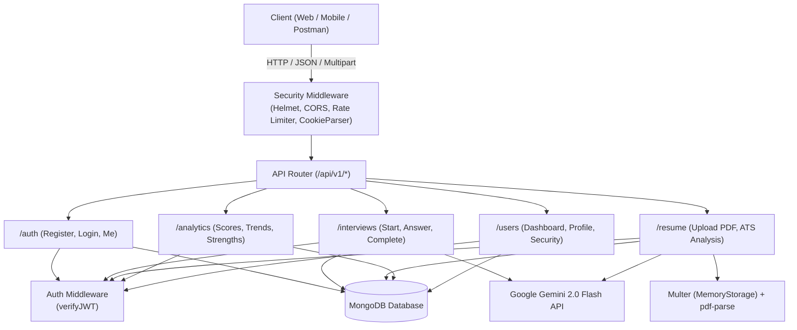

# 🎙️ AI Interview Assistant API

[](https://nodejs.org/)
[](https://expressjs.com/)
[](https://www.mongodb.com/)
[](https://ai.google.dev/)
[](https://zod.dev/)
[](LICENSE)

An intelligent, production-ready backend REST API built with **Express 5**, **MongoDB**, and **Google Gemini 2.0 Flash AI**. The platform powers an end-to-end AI-driven interview preparation experience featuring dynamic role-specific question generation, real-time answer evaluation with actionable scoring, PDF resume ATS analysis, and candidate performance tracking.

---

## 📑 Table of Contents

- [Overview](#-overview)
- [Key Features](#-key-features)
- [Architecture & Tech Stack](#-architecture--tech-stack)
- [System Architecture Diagram](#-system-architecture-diagram)
- [Project Directory Structure](#-project-directory-structure)
- [Database Schema](#-database-schema)
- [Getting Started](#-getting-started)
  - [Prerequisites](#prerequisites)
  - [Installation](#installation)
  - [Environment Configuration](#environment-configuration)
  - [Running the Server](#running-the-server)
- [API Reference](#-api-reference)
  - [Health Check](#health-check)
  - [Authentication](#authentication-apiv1auth)
  - [Interview Sessions](#interview-sessions-apiv1interviews)
  - [Resume ATS Analysis](#resume-ats-analysis-apiv1resume)
  - [Analytics & Performance](#analytics-apiv1analytics)
  - [User & Dashboard](#user--dashboard-apiv1users)
- [Unified API Response Convention](#-unified-api-response-convention)
- [End-to-End Workflow Guide](#-end-to-end-workflow-guide)
- [Security & Best Practices](#-security--best-practices)
- [Future Enhancements](#-future-enhancements)
- [License](#-license)

---

## 💡 Overview

Preparing for technical, behavioral, and HR interviews is often disjointed and subjective. The **AI Interview Assistant API** bridges this gap by acting as an on-demand personal interviewer and career coach:

1. **Simulate Real Interviews**: Candidates can launch customized interview sessions by target role (e.g., *Full Stack Developer*, *DevOps Engineer*, *Data Scientist*) and difficulty (*easy*, *medium*, *hard*).
2. **Instant AI Feedback**: Responses are analyzed in real time with numerical scores (0–100), personalized strengths, and targeted improvement suggestions.
3. **Resume ATS Optimization**: Upload a PDF resume to extract skills, discover missing competencies for a desired target role, and calculate an ATS friendliness score.
4. **Data-Driven Progress**: Aggregated metrics monitor long-term growth across topics, identifying strengths and weak areas.

---

## ✨ Key Features

- **🎯 Dynamic AI Question Generator**: Leverages Google Gemini 2.0 Flash to synthesize structured, role-specific questions across technical, behavioral, and HR categories.
- **🧠 Real-Time Answer Evaluation**: Grades candidate responses against role expectations with contextual scores, qualitative feedback, strengths, and critique.
- **📄 PDF Resume ATS Analyzer**: Extracts text from uploaded PDF resumes in memory using `pdf-parse`, parses technical & soft skills, scores ATS readiness, and detects skill gaps.
- **📈 Candidate Analytics & Insights**: Tracks average scores, completed interviews, score trends over time, and automatically flags strong (>= 70%) and weak (< 50%) topics.
- **🔐 Secure Authentication & User Profiles**: Stateless JWT authentication with both HTTP-only cookies and Authorization Bearer header support, plus bcrypt password hashing.
- **🛡️ Built-in Security**:
  - **Helmet** for secure HTTP headers.
  - **Express Rate Limiting** (100 requests per 15 minutes on `/api`).
  - **CORS** support with configurable origins.
  - **Zod Schema Validation** for robust request body sanitation.
  - **Standardized Error Handling** with custom `ApiError` and `ApiResponse` wrappers.

---

## 🛠 Architecture & Tech Stack

| Layer | Technology | Description |
| :--- | :--- | :--- |
| **Runtime** | [Node.js (v18+)](https://nodejs.org/) | JavaScript runtime engine |
| **Framework** | [Express.js (v5)](https://expressjs.com/) | RESTful API routing and middleware pipeline |
| **Database** | [MongoDB](https://www.mongodb.com/) / [Mongoose](https://mongoosejs.com/) | NoSQL database with strict schema modeling |
| **AI Engine** | [Google Gemini 2.0 Flash](https://ai.google.dev/) (`@google/generative-ai`) | Question generation, answer grading & resume inspection |
| **Document Processing**| [pdf-parse](https://www.npmjs.com/package/pdf-parse) & [Multer](https://www.npmjs.com/package/multer) | PDF text parsing with in-memory buffer storage |
| **Security & Auth** | `jsonwebtoken`, `bcrypt`, `helmet`, `cors` | Token verification, password hashing, and HTTP security |
| **Validation** | [Zod](https://zod.dev/) | Strict runtime input schema validation |
| **Logging & Dev** | `morgan`, `nodemon`, `dotenv` | HTTP request logging and hot reloading |

---

## 🏛 System Architecture Diagram



---

## 📂 Project Directory Structure

```text
ai-interview-assistant-api/
│
├── constants.js                   # Application constants (e.g., DB name)
├── app.js                         # Express app instance, security middlewares & route mounting
├── index.js                       # Server entry point & database initialization
├── package.json                   # Project manifest, dependencies and scripts
├── .env.example                   # Template environment variables file
├── .gitignore                     # Git ignore rules
│
└── src/
    ├── .env                       # Local environment variables (do not commit secrets)
    │
    ├── controllers/               # Request handling & business logic
    │   ├── auth.controller.js       # Register, login, logout, me
    │   ├── interview.controller.js  # Start session, evaluate answers, complete/cancel
    │   ├── resume.controller.js     # PDF upload, text extraction, ATS scoring
    │   ├── analytics.controller.js  # Aggregate candidate scores & trends
    │   └── user.controller.js       # Dashboard, profile updates, security
    │
    ├── db/                        # Database connectivity
    │   └── index.js                 # Mongoose connection logic
    │
    ├── middlewares/               # Custom Express middlewares
    │   ├── auth.middleware.js       # JWT cookie & Bearer token verification
    │   ├── error.middleware.js      # Global error format handler
    │   ├── multer.middleware.js     # In-memory PDF upload and validation
    │   └── validate.middleware.js   # Zod schema validation middleware
    │
    ├── models/                    # Mongoose database schemas
    │   ├── user.model.js               # User accounts & roles
    │   ├── interviewSession.model.js   # Interview session metadata
    │   ├── question.model.js           # AI-generated interview questions
    │   ├── response.model.js           # Candidate answers & AI evaluations
    │   ├── resumeAnalysis.model.js     # Extracted resume data & ATS scores
    │   └── interviewAnalytics.model.js # Cached candidate performance stats
    │
    └── utils/                     # Helper utilities
        ├── ApiError.js              # Standardized API Error class
        ├── ApiResponse.js            # Standardized API Response formatter
        ├── asyncHandler.js          # Express async route wrapper
        └── validators.js            # Zod validation schemas
```

---

## 🗄 Database Schema

The database consists of 6 interconnected Mongoose models:

- **`User`**: Stores candidate information (`name`, `email`, `passwordHash`, `role`, `targetRole`).
- **`InterviewSession`**: Represents a mock interview round (`userId`, `role`, `difficulty`, `status`, `overallScore`, `startedAt`, `completedAt`).
- **`Question`**: Questions generated for a session (`sessionId`, `text`, `type`, `topic`, `order`, `generatedBy`).
- **`Response`**: Candidate answer submissions (`sessionId`, `questionId`, `answerText`, `score`, `aiFeedback`, `strengths`, `improvements`).
- **`ResumeAnalysis`**: Output from parsed resumes (`userId`, `originalFileName`, `fileSize`, `extractedSkills`, `skillGaps`, `atsScore`, `recommendations`).
- **`InterviewAnalytics`**: Aggregated performance metrics (`userId`, `totalInterviews`, `averageScore`, `avgScoreByTopic`, `strongTopics`, `weakTopics`, `progressTrend`).

---

## 🚀 Getting Started

### Prerequisites

- [Node.js](https://nodejs.org/) (v18.0.0 or higher)
- [MongoDB](https://www.mongodb.com/) (Local instance or MongoDB Atlas connection string)
- [Google AI Studio API Key](https://aistudio.google.com/) (for Gemini 2.0 Flash)

### Installation

1. **Clone the repository:**
   ```bash
   git clone https://github.com/parmarashokbs-netizen/ai-interview-assistant-api.git
   cd ai-interview-assistant-api
   ```

2. **Install dependencies:**
   ```bash
   npm install
   ```

### Environment Configuration

Create a `.env` file inside the `src/` directory (or use `.env.example` as a template):

```bash
cp .env.example src/.env
```

Fill in your configuration variables in `src/.env`:

```env
# ==========================================
# Server Configuration
# ==========================================
PORT=8000
NODE_ENV=development

# ==========================================
# MongoDB Configuration
# ==========================================
MONGODB_URI=mongodb+srv://<username>:<password>@cluster0.xxxxx.mongodb.net
DB_NAME=ai-interview-assistant

# ==========================================
# JWT Authentication Configuration
# ==========================================
JWT_SECRET=your_jwt_secret_key_minimum_32_characters
JWT_EXPIRY=7d

# ==========================================
# Google Gemini API Configuration
# ==========================================
GEMINI_API_KEY=your_google_gemini_api_key

# ==========================================
# CORS Configuration
# ==========================================
CORS_ORIGIN=*
```

### Running the Server

- **Development Mode (with hot reload via nodemon):**
  ```bash
  npm run dev
  ```

- **Production Mode:**
  ```bash
  node index.js
  ```

Once running, verify the server by visiting:
```
http://localhost:8000/api/v1/health
```

---

## 📡 API Reference

All API routes are prefixed with `/api/v1`.

### Health Check

| Method | Endpoint | Access | Description |
| :--- | :--- | :--- | :--- |
| `GET` | `/api/v1/health` | Public | System health and environment check |

**Response Example:**
```json
{
  "success": true,
  "message": "AI Interview Assistant API is running",
  "timestamp": "2026-10-11T16:24:00.000Z",
  "environment": "development"
}
```

---

### Authentication (`/api/v1/auth`)

| Method | Endpoint | Access | Description |
| :--- | :--- | :--- | :--- |
| `POST` | `/api/v1/auth/register` | Public | Register a new user |
| `POST` | `/api/v1/auth/login` | Public | Login with email & password |
| `POST` | `/api/v1/auth/logout` | Protected | Clear JWT authentication cookie |
| `GET` | `/api/v1/auth/me` | Protected | Retrieve currently authenticated user profile |

#### `POST /api/v1/auth/register`
**Request Body:**
```json
{
  "name": "Jane Doe",
  "email": "jane@example.com",
  "password": "SecretPassword123",
  "targetRole": "Backend Engineer"
}
```

#### `POST /api/v1/auth/login`
**Request Body:**
```json
{
  "email": "jane@example.com",
  "password": "SecretPassword123"
}
```

**Response Example:**
```json
{
  "statusCode": 200,
  "data": {
    "user": {
      "_id": "67a9...",
      "name": "Jane Doe",
      "email": "jane@example.com",
      "role": "candidate",
      "targetRole": "Backend Engineer"
    },
    "token": "eyJhbGciOi..."
  },
  "message": "User logged in successfully",
  "success": true
}
```

---

### Interview Sessions (`/api/v1/interviews`)

*All interview routes require authentication.*

| Method | Endpoint | Description |
| :--- | :--- | :--- |
| `POST` | `/api/v1/interviews/start` | Start an interview session & generate AI questions |
| `GET` | `/api/v1/interviews` | Fetch all user interview sessions (with pagination & status filter) |
| `GET` | `/api/v1/interviews/:sessionId` | Get details of a session, its questions, and answers |
| `POST` | `/api/v1/interviews/:sessionId/answer` | Submit an answer to a question and get instant AI evaluation |
| `PATCH` | `/api/v1/interviews/:sessionId/complete` | Complete the interview and compute overall score |
| `PATCH` | `/api/v1/interviews/:sessionId/cancel` | Cancel an in-progress interview session |

#### `POST /api/v1/interviews/start`
**Request Body:**
```json
{
  "role": "Frontend Developer",
  "difficulty": "medium"
}
```
*`difficulty` options: `easy`, `medium`, `hard`.*

**Response Example:**
```json
{
  "statusCode": 201,
  "data": {
    "session": {
      "_id": "67a9f...",
      "role": "Frontend Developer",
      "difficulty": "medium",
      "status": "in-progress"
    },
    "questions": [
      {
        "_id": "67a9f...",
        "text": "Can you explain how React's Virtual DOM works and how it differs from the real DOM?",
        "type": "technical",
        "topic": "React",
        "order": 1
      }
    ]
  },
  "message": "Interview session started successfully",
  "success": true
}
```

#### `POST /api/v1/interviews/:sessionId/answer`
**Request Body:**
```json
{
  "questionId": "67a9f...",
  "answerText": "The Virtual DOM is an in-memory lightweight representation of the real DOM. When state changes, React updates the virtual tree, diffs it using reconciliation, and patches only changed nodes."
}
```

**Response Example:**
```json
{
  "statusCode": 201,
  "data": {
    "response": {
      "score": 88,
      "aiFeedback": "Clear and accurate explanation covering reconciliation and targeted DOM updates.",
      "strengths": [
        "Mentioned in-memory representation",
        "Understands reconciliation concept"
      ],
      "improvements": [
        "Could mention keys in list rendering",
        "Could highlight fiber reconciliation engine"
      ]
    }
  },
  "message": "Answer submitted and evaluated successfully",
  "success": true
}
```

---

### Resume ATS Analysis (`/api/v1/resume`)

*All resume routes require authentication.*

| Method | Endpoint | Description |
| :--- | :--- | :--- |
| `POST` | `/api/v1/resume/analyze` | Upload a PDF resume (`multipart/form-data`) for AI ATS scoring |
| `GET` | `/api/v1/resume` | List all historical resume analyses for the user |
| `GET` | `/api/v1/resume/:analysisId` | Fetch a specific resume analysis report |

#### `POST /api/v1/resume/analyze`
- **Form Data Field:** `resume` (PDF file, max 5MB)
- **Optional Field:** `targetRole` (string, e.g., `"Cloud Architect"`)

**Response Example:**
```json
{
  "statusCode": 201,
  "data": {
    "analysis": {
      "_id": "67aa...",
      "originalFileName": "Jane_Doe_Resume.pdf",
      "fileSize": 128450,
      "atsScore": 82,
      "extractedSkills": [
        "JavaScript", "TypeScript", "Node.js", "Express", "Docker", "MongoDB"
      ],
      "skillGaps": [
        "Kubernetes", "AWS ECS", "CI/CD Pipeline Design"
      ],
      "recommendations": [
        "Quantify project impacts using metrics and KPIs (e.g., reduced latency by 30%).",
        "Add certifications related to cloud architecture to better align with the target role."
      ]
    }
  },
  "message": "Resume analyzed successfully",
  "success": true
}
```

---

### Analytics (`/api/v1/analytics`)

*All analytics routes require authentication.*

| Method | Endpoint | Description |
| :--- | :--- | :--- |
| `GET` | `/api/v1/analytics` | Retrieve candidate's performance statistics, topic scores, and progress |
| `POST` | `/api/v1/analytics/refresh` | Recompute performance metrics based on latest completed interviews |

**Response Example:**
```json
{
  "statusCode": 200,
  "data": {
    "analytics": {
      "totalInterviews": 5,
      "averageScore": 79,
      "avgScoreByTopic": {
        "React": 85,
        "System Design": 65,
        "Algorithms": 72
      },
      "strongTopics": ["React", "Algorithms"],
      "weakTopics": ["System Design"],
      "progressTrend": [
        { "date": "2026-10-01T10:00:00.000Z", "score": 70 },
        { "date": "2026-10-10T12:00:00.000Z", "score": 88 }
      ]
    }
  },
  "message": "Analytics fetched successfully",
  "success": true
}
```

---

### User & Dashboard (`/api/v1/users`)

*All user routes require authentication.*

| Method | Endpoint | Description |
| :--- | :--- | :--- |
| `GET` | `/api/v1/users/dashboard` | Aggregated dashboard summary (interview stats, resume info, recent sessions) |
| `PATCH` | `/api/v1/users/profile` | Update user name and target role |
| `PATCH` | `/api/v1/users/change-password` | Update account password |
| `DELETE` | `/api/v1/users/account` | Permanently delete account and all associated data |

---

## 📦 Unified API Response Convention

All successful responses follow the standard `ApiResponse` structure:

```json
{
  "statusCode": 200,
  "data": { ... },
  "message": "Operation completed successfully",
  "success": true
}
```

All errors follow the unified `ApiError` format handled by the global error middleware:

```json
{
  "success": false,
  "statusCode": 400,
  "message": "Invalid credentials or validation failed",
  "errors": [],
  "stack": "Error: ... (in development only)"
}
```

---

## 🧪 End-to-End Workflow Guide

Here is how to test the complete user lifecycle using `curl`:

### 1. Register & Login
```bash
# Register
curl -X POST http://localhost:8000/api/v1/auth/register \
  -H "Content-Type: application/json" \
  -d '{"name":"Alex Rivers","email":"alex@example.com","password":"Password123!","targetRole":"Backend Developer"}'

# Login
curl -X POST http://localhost:8000/api/v1/auth/login \
  -H "Content-Type: application/json" \
  -d '{"email":"alex@example.com","password":"Password123!"}'
```

### 2. Start an Interview
```bash
curl -X POST http://localhost:8000/api/v1/interviews/start \
  -H "Content-Type: application/json" \
  -H "Authorization: Bearer <YOUR_TOKEN>" \
  -d '{"role":"Backend Developer","difficulty":"medium"}'
```

### 3. Submit Answers
```bash
curl -X POST http://localhost:8000/api/v1/interviews/<SESSION_ID>/answer \
  -H "Content-Type: application/json" \
  -H "Authorization: Bearer <YOUR_TOKEN>" \
  -d '{"questionId":"<QUESTION_ID>","answerText":"Indexing enhances lookup speed using B-Trees at the cost of additional write overhead."}'
```

### 4. Complete the Interview
```bash
curl -X PATCH http://localhost:8000/api/v1/interviews/<SESSION_ID>/complete \
  -H "Authorization: Bearer <YOUR_TOKEN>"
```

### 5. Upload Resume for ATS Analysis
```bash
curl -X POST http://localhost:8000/api/v1/resume/analyze \
  -H "Authorization: Bearer <YOUR_TOKEN>" \
  -F "resume=@/path/to/resume.pdf" \
  -F "targetRole=Backend Developer"
```

### 6. View Overall Dashboard
```bash
curl -X GET http://localhost:8000/api/v1/users/dashboard \
  -H "Authorization: Bearer <YOUR_TOKEN>"
```

---

## 🔒 Security & Best Practices

- **Zero Plaintext Passwords**: Passwords hashed using `bcrypt` with 10 salt rounds.
- **Secure Token Delivery**: Tokens issued via HTTP-only, SameSite cookies and optional Bearer headers.
- **Strict Data Sanitization**: Request payloads validated via declarative Zod schemas before reaching controllers.
- **In-Memory File Processing**: PDF resumes are buffered in memory and never stored on local disks, preserving candidate privacy.
- **DDoS & Brute Force Prevention**: Protected by `express-rate-limit` and HTTP header hardening via `helmet`.

---

## 🔮 Future Enhancements

- [ ] **Voice / Audio Interviews**: Integration with WebRTC and speech-to-text models for verbal responses.
- [ ] **Code Execution Sandbox**: Safe execution runtime for live coding challenges.
- [ ] **Custom Question Bank**: Allow organizations to supply company-specific question sets alongside AI generation.
- [ ] **WebSocket Real-time Assistant**: Streaming AI responses and conversational back-and-forth follow-up questions.

---

## 📄 License

This project is licensed under the [ISC License](LICENSE).
